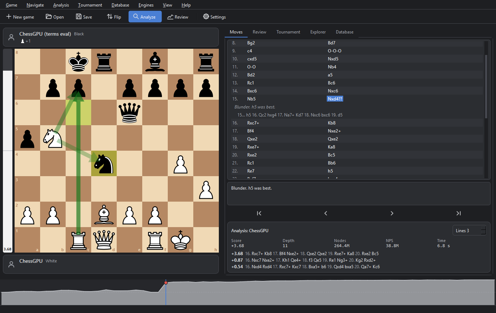
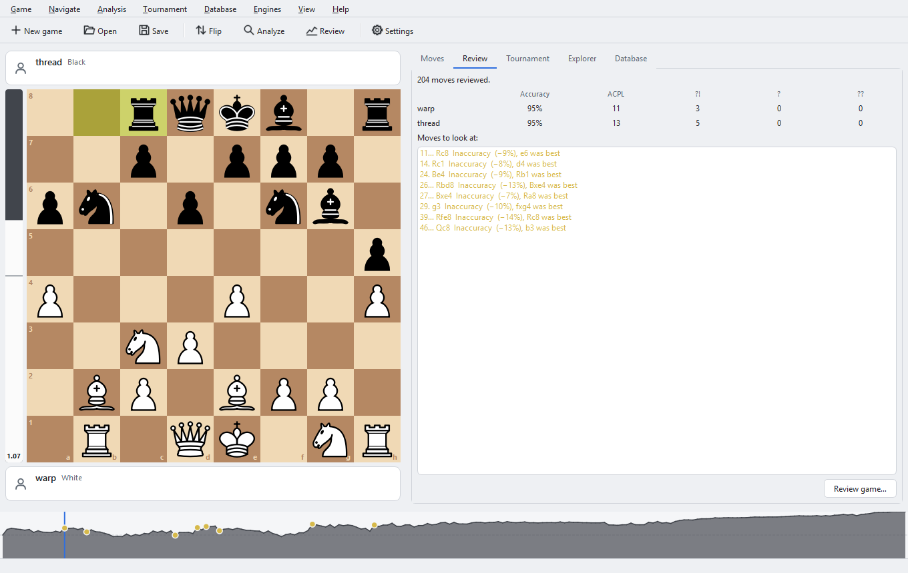
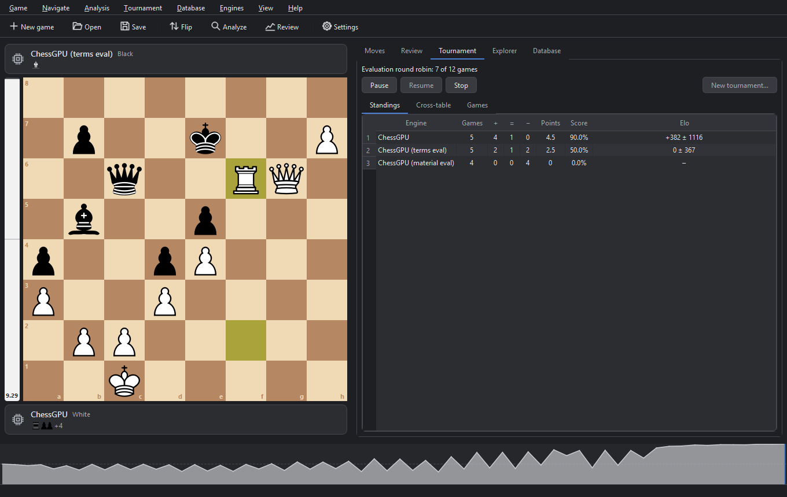
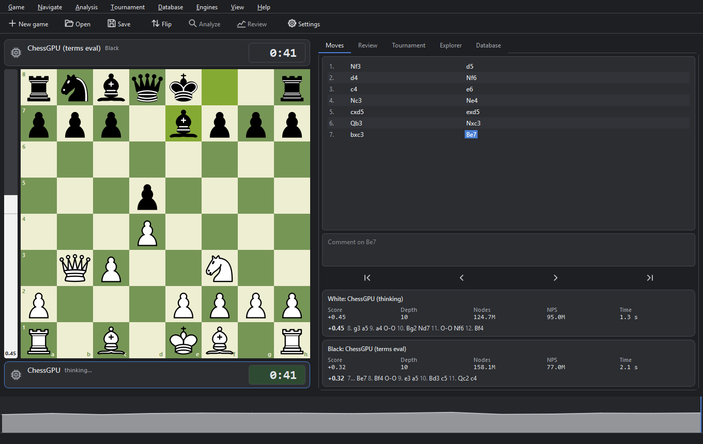
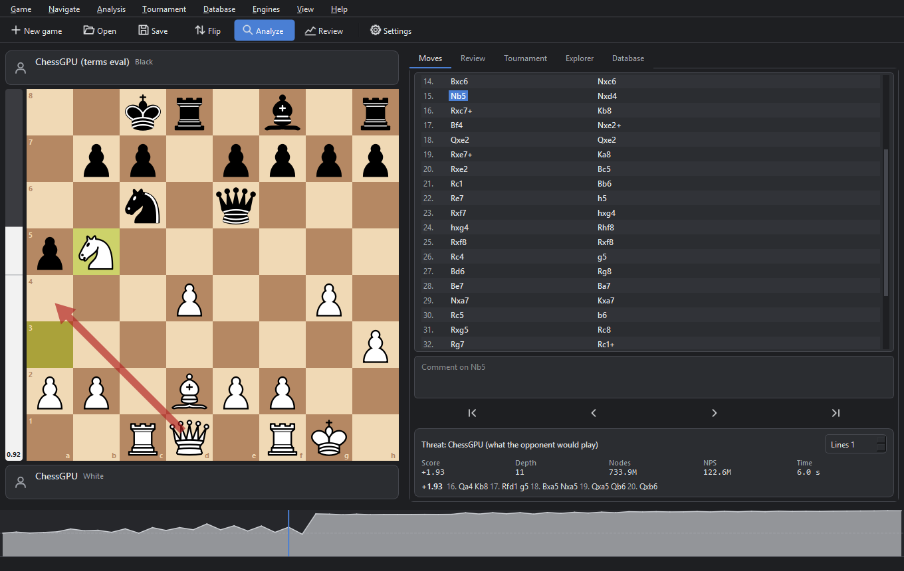
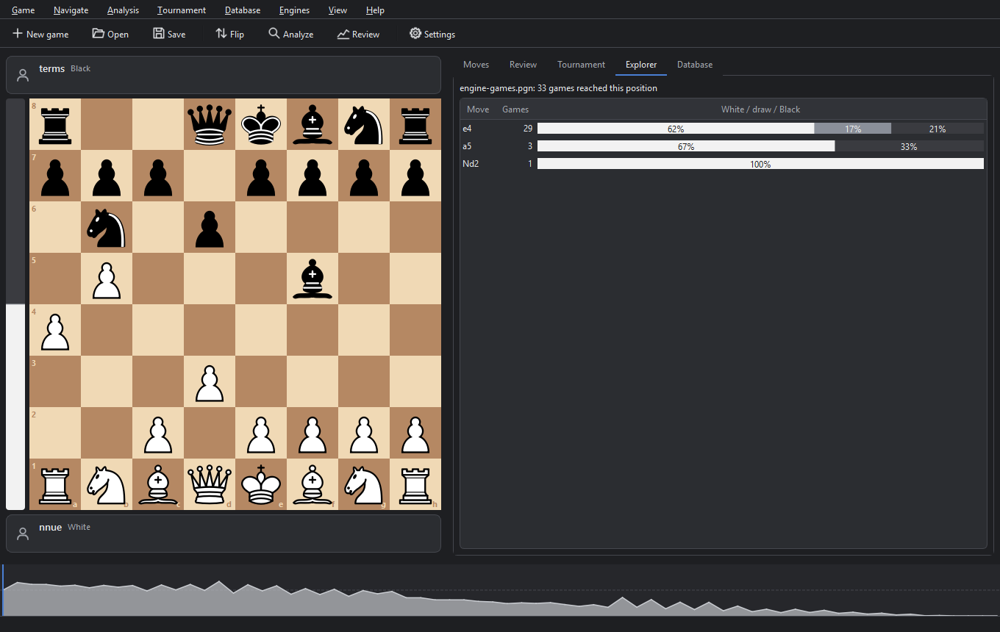
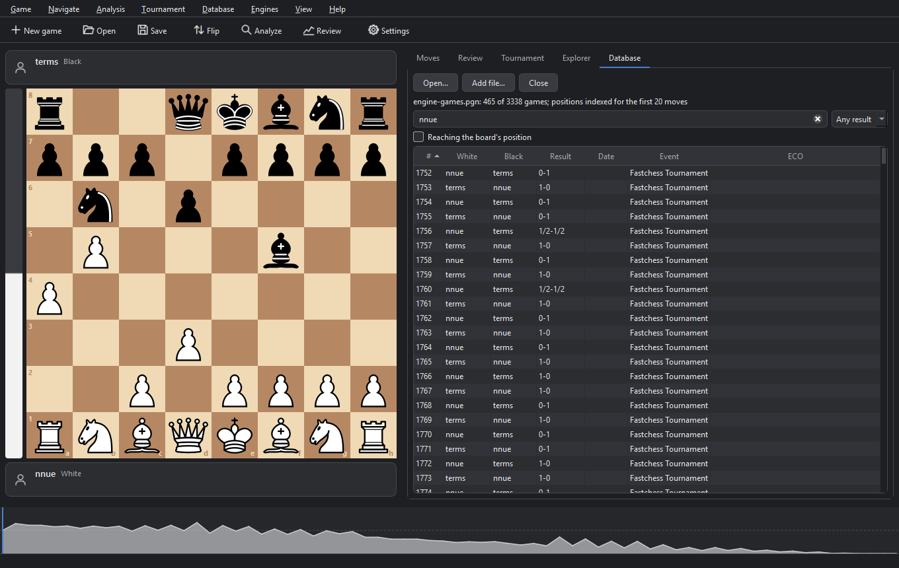

# ChessGPU

A UCI chess engine with its search on the GPU, written in C++20 and CUDA, and a desktop GUI written in Python with PySide6.




ChessGPU runs parallel alpha-beta searches on an NVIDIA GPU. The search algorithm, evaluation, board representation and pruning techniques are variants chosen at run time, so they can be benchmarked and played against each other. The GUI plays, analyzes and reviews games, runs engine tournaments and opens PGN databases, with ChessGPU or any other UCI engine.

## Quickstart

Requirements:
- Windows, Visual Studio 2026, CMake 3.28 or newer, CUDA Toolkit 13.2
- An NVIDIA GPU of compute capability 7.5 (Turing) or newer. The build targets the GPU in the machine; it has been tested on compute capability 12.0 (Blackwell).
- Python 3, for the GUI

Build the engine (`build/Release/chessgpu.exe`):

```bash
cmake --preset default
cmake --build --preset release
```

Set up and start the GUI:

```bash
python -m venv .venv
.venv/Scripts/pip install -r gui/requirements.txt
.venv/Scripts/python gui/main.py
```

The first build compiles all variants of the search and takes a while; [ENGINE.md](docs/ENGINE.md#building) lists the CMake options that build fewer. In the GUI, **Game → New game** starts a game, and **Engines → Manage engines** adds other engines such as Stockfish. Other UCI GUIs and match runners can run `build/Release/chessgpu.exe` directly.

## Search algorithms

These are ways to run one alpha-beta search on many threads, plus a sequential version on one CPU core. They share the same search code, compiled for both the CPU and the GPU, and iterative deepening, time management and MultiPV work with any of them.

| Algorithm | Runs on | Status |
|---|---|---|
| Young Brothers Wait Concept (YBWC), coordinated on the GPU | GPU | implemented (default) |
| YBWC, coordinated by the CPU | CPU and GPU | implemented |
| Independent subtrees | CPU and GPU | implemented |
| ABDADA | GPU or CPU threads | implemented |
| Sequential | one CPU core | implemented |
| YBWC with the critical path on CPU threads | CPU and GPU | planned |
| Lazy SMP | GPU | planned |
| APHID | GPU | planned |

Also planned: Monte Carlo tree search (MCTS) on the GPU.

## Engine

- Evaluation: NNUE (768 inputs, 2 × 32 hidden neurons; default), PeSTO's tables with hand-written terms, PeSTO's tables, or material.
- Search techniques: transposition table, killer moves, and SEE and delta pruning in quiescence (the default set). Null-move pruning, late move reductions, futility pruning, check extensions, principal variation search, checks in quiescence and aspiration windows are available as other sets.
- Board representation: 4 bitboards (default) or 8 bitboards.
- GPU execution model: one search per thread (default) or one per warp.
- Sliding-piece attacks: hyperbola quintessence (GPU search), magic bitboards (CPU search), Kogge-Stone (perft).
- Moves: 16-bit encoding; 32-bit as a perft variant.
- The variants are UCI options. The executable also runs perft, benchmarks, self-play and NNUE training from the command line.

## GUI

- Games between people and engines, or engine against engine, with clocks, premoves and takebacks
- Analysis with up to five lines, threat mode and hints
- Game trees with variations, comments, annotation marks, arrows and circles
- Game review: inaccuracies, mistakes and blunders, and accuracy per side
- Engine tournaments: round robin or gauntlet, standings with Elo estimates, cross-table, resume after closing
- PGN databases: search, position filter, opening explorer, opening book for engines
- Dark and light themes, six board colors, three piece sets, sounds

## Screenshots

| Game review (light theme) | Engine tournament |
|:-:|:-:|
|  |  |
| **Engine against engine** | **Threat mode** |
|  |  |
| **Opening explorer** | **Game database** |
|  |  |

[docs/GUI.md](docs/GUI.md) has more, including the dialogs.

## Documentation

| Document | Contents |
|---|---|
| [docs/GUI.md](docs/GUI.md) | Using the GUI |
| [docs/ENGINE.md](docs/ENGINE.md) | Building the engine, UCI options, command-line tools, NNUE training |
| [docs/DEVELOPMENT.md](docs/DEVELOPMENT.md) | Builds, tests, benchmarks, matches, conventions |
| [docs/ARCHITECTURE.md](docs/ARCHITECTURE.md) | How ChessGPU works, with measurements, and what is planned |

## Testing

The C++ tests check move generation against perft counts (verified with Stockfish) and a separate rules implementation, the CPU search against a recursive reference search, and the GPU searches against the CPU. The GPU tests also run under compute-sanitizer. The GUI has its own pytest suite.

```bash
ctest --preset release          # labels: unit, gpu, engine, perft, sanitizer, gui
```

## Repository layout

| Path | Contents |
|---|---|
| `src/core/` | Header-only chess code for CPU and GPU: boards, move generation, evaluation, search |
| `src/gpu/` | CUDA kernels and their host code: perft, search workers, YBWC, ABDADA |
| `src/host/` | CPU-side code: FEN, CPU search, iterative deepening, time management, MultiPV, self-play, training |
| `src/engine/` | UCI engine and command line |
| `tests/` | C++ tests, perft suites, benchmark positions, match openings |
| `scripts/` | Benchmarks, match runner, planted-bug campaigns, Stockfish helpers |
| `gui/` | GUI and its tests |
| `docs/` | Documentation |

## Credits

- PeSTO's evaluation tables by Ronald Friederich, as published on the Chess Programming Wiki.
- The cburnett chess pieces by Cburnett (Wikimedia Commons), under the BSD 3-clause license (`gui/chessgpu_gui/assets/pieces/cburnett/LICENSE.txt`).
- [Qt for Python (PySide6)](https://doc.qt.io/qtforpython-6/) for the GUI, [fastchess](https://github.com/Disservin/fastchess) for engine matches, and [Stockfish](https://stockfishchess.org/) as a perft reference and GUI opponent. None of them is included.

## License

MIT; see [LICENSE](LICENSE). The cburnett piece images keep their BSD 3-clause license.
