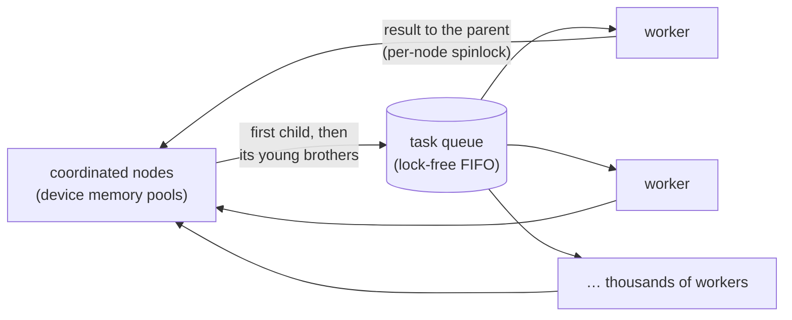

# Architecture

ChessGPU is a chess engine whose alpha-beta search runs on the GPU, written in C++20 and CUDA, with a separate Python GUI. This document describes how it is built, the measurements behind its defaults, and what is planned. Using the engine is covered in [ENGINE.md](ENGINE.md), using the GUI in [GUI.md](GUI.md), and building and testing in [DEVELOPMENT.md](DEVELOPMENT.md).

Contents:
[Overview](#overview) ·
[Investigated and planned](#investigated-and-planned) ·
[Code organization](#code-organization) ·
[Board representation](#board-representation) ·
[Move generation](#move-generation) ·
[Evaluation](#evaluation) ·
[Search](#search) ·
[Parallel search on the GPU](#parallel-search-on-the-gpu) ·
[Engine](#engine) ·
[GUI](#gui) ·
[Variants and build](#variants-and-build) ·
[Testing](#testing) ·
[Results](#results) ·
[Future work](#future-work) ·
[Hardware](#hardware)

## Overview

```text
Python GUI  <-- UCI text over stdin/stdout pipes -->  chessgpu.exe (C++/CUDA)
```

- The engine is a console program that speaks [UCI](https://www.chessprogramming.org/UCI), so other GUIs and match runners can use it. The GUI (PySide6) starts it as a separate process and exchanges text lines with it; there are no bindings or shared memory.
- The search is header-only `__host__ __device__` code, written as an explicit-stack loop. The same code runs on the CPU, on one GPU thread or on one GPU warp, and the tests require these implementations to search the same tree.
- The default parallel search is Young Brothers Wait Concept (YBWC), coordinated on the GPU in one persistent kernel per iteration. Thousands of workers search subtrees with shared bounds.
- Most design choices are template parameters: boards, execution models, evaluations, move ordering, stack placement, pruning feature sets, table layouts, attack generators and move encodings. The combinations compile into one binary and the host picks one at run time. Benchmarks and matches decide the defaults; the other variants stay available.

**Default configuration:** the GPU-resident YBWC (leaf depth 2, node budget 2048, cut waves, one working thread per warp), the thread execution model, the quad board, staged move ordering, the stack in local memory, hyperbola-quintessence attacks on the GPU (magic bitboards on the CPU), the NNUE evaluation, and the feature set `tt-killers-see`: a transposition table (wide128 layout), killer moves, and SEE plus delta pruning in quiescence.

**Main results** (details in [Results](#results)):
- Without a transposition table, the GPU-resident YBWC is 5.7 times faster than one CPU core to depth 8, and 8.3 times faster to depth 9. Up to depth 6 it is no faster: YBWC searches each node's first move before its brothers, and that chain runs on one GPU thread at about 270k nodes per second, against about 10M on a CPU core.
- The transposition table, killer moves and SEE pruning in quiescence won their matches. Null moves and late move reductions lost: the narrow trees they produce make the single-threaded chain of first moves nearly all the work.
- Hand-written evaluation terms beat PeSTO's tables despite costing 45% in time to depth, and a small NNUE trained on the engine's own games then beat the terms.

## Investigated and planned

*Default* is what the engine uses, *variant* is built and selectable at run time, *planned* is not built yet. Times are time to depth on the 50-position suite unless noted; Elo figures are SPRT matches at 10+0.1 against the previous default ([Results](#results)).

**Search algorithms.** All but MCTS are ways to parallelize the same alpha-beta search.

| Algorithm | Status | Result |
|---|---|---|
| YBWC, coordinated on the GPU | default | depth 7 in 16.0 s, against 34.5 s on one CPU core (no table) |
| YBWC, coordinated by the CPU in rounds of GPU batches | variant | depth 7 in 54.6 s |
| Independent subtrees: the CPU expands the first plies, the GPU searches the subtrees without shared bounds | variant | 156 times the nodes of one CPU core (start position, depth 7) |
| ABDADA on the GPU | variant | 1.4 times slower than YBWC to depth 8, with 13 times the nodes |
| ABDADA on CPU threads | variant | 5.7 times faster than one core with 8 threads |
| Sequential alpha-beta on one CPU core | reference | |
| YBWC with the critical path on CPU threads and the young brothers on the GPU | planned | |
| Lazy SMP | planned | |
| APHID | planned | |
| Monte Carlo tree search (MCTS) | planned | |

**Search techniques**

| Technique | Status | Match |
|---|---|---|
| Transposition table | default | +355 ± 67 |
| Killer moves | default | +47 ± 31 |
| SEE and delta pruning in quiescence | default | +73 ± 48 |
| Null-move pruning | variant | −24 ± 35 |
| Late move reductions | variant | −235 ± 54 |
| Futility pruning | variant | not played (no time gain) |
| Check extensions | variant | +1 ± 33 |
| Aspiration windows | variant | −32 ± 39 |
| Principal variation search | variant | not played yet |
| Checks in quiescence | variant | not played yet; −55 ± 57 with null moves |
| Static order for quiet moves | planned | |
| Null moves with a verification search | planned | |

**Evaluation**

| Evaluation | Status | Match |
|---|---|---|
| Material | variant | |
| PeSTO's piece-square tables | variant | +651 ± 260 over material |
| PeSTO's tables with 17 hand-written terms | variant | +66 ± 26 over PeSTO |
| NNUE, 768 inputs and 2 × 32 hidden neurons | default | +64 ± 50 over the terms |
| A larger NNUE, trained on more varied games | planned | |

**Board, move generation and GPU execution**

| Choice | Options (default first) | Result |
|---|---|---|
| Board | 4 bitboards, 8 bitboards | 72 registers per thread instead of 90 in perft; tie in the search |
| Execution model | one search per GPU thread, one per warp | +110 ± 34; the warp model is 68% slower to depth 8 |
| Move ordering | staged, full list | the list is 89% slower to depth 8 |
| Search stack | local memory, shared memory | shared memory is 23% slower to depth 8 |
| Sliding-piece attacks | hyperbola quintessence in the GPU search, magic bitboards on the CPU, Kogge-Stone in perft | magic bitboards: 1.9 times faster on the CPU, 12% slower in the GPU search |
| Move encoding | 16-bit, 32-bit (perft) | 32-bit is 19% to 2 times slower in GPU perft |
| Transposition table entries | 128-bit, 64-bit | 128-bit is 11% faster to depth |
| Perft split on the GPU | planned | |

[Future work](#future-work) describes the planned items.

## Code organization

```text
src/core/     header-only chess code compiled for both CPU and GPU: boards, attacks, move generation,
              perft, evaluations, Zobrist keys, move ordering, SEE, search, transposition table,
              feature sets, YBWC node rules
src/host/     host-only code: FEN and validation, UCI move strings, perft suites, CPU perft and search,
              game history, task runners, YBWC coordination on the CPU, iterative deepening and time
              management, Texel tuner, self-play, NNUE trainer
src/gpu/      device setup, perft and search kernels and their host drivers, device transposition table,
              GPU-resident YBWC, GPU ABDADA; kernels.cu.in is the template of the generated kernel units
src/engine/   the UCI protocol and backend factory (a library), and the command line
tests/        CPU, GPU, engine and perft tests; perft suites and search positions
scripts/      benchmarks, match runner, planted-bug campaigns, Stockfish helpers
gui/          the PySide6 GUI, its tests and piece images
```

**Shared host/device code:** everything in `src/core/` is marked `CB_HD` (`__host__ __device__`), with intrinsics chosen per side (`__popcll` on the GPU, `std::popcount` on the CPU). Unit tests and debugging run on the CPU against exactly the code the GPU runs. Calling host-only code from `CB_HD` code is a compile error (`--Werror cross-execution-space-call`).

## Board representation

Two implementations sit behind one interface:

| | `StdBoard` | `QuadBoard` |
|---|---|---|
| Storage | 8 bitboards: 6 piece types + 2 colors | 4 bitboards: a color bit and 3 type bits per square |
| Size | 512 bits (16 registers) | 256 bits (8 registers) |
| Piece masks | stored directly | built with 1-3 bit operations |

`QuadBoard` is the default: about 3% faster in perft, with 72 registers per thread instead of 90 in the thread-model kernel, which raises theoretical occupancy from 42% to 58%. Under search the two tie.

**QuadBoard encoding.** Each square has a color bit `c` (1 = black, 0 on empty squares) and a 3-bit type `t2 t1 t0`: empty 000, pawn 001, knight 010, bishop 011, rook 100, queen 101, king 110. The codes are chosen so the masks attack generation needs most are cheapest:

```cpp
occupied = t0 | t1 | t2;
knights  = ~t0 & t1 & ~t2;   // 010
diagonal = t0 & (t1 ^ t2);   // bishops + queens
straight = t2 & ~t1;         // rooks + queens
```

**Conventions.** Squares are `rank * 8 + file` (a1 = 0, h8 = 63). A 32-bit state word holds castling rights, the en passant file, the side to move and the halfmove clock. An undo word holds the previous state and the captured piece type.

**Interface.** A board class provides only primitives: `pieces<PieceType>()`, `color(c)`, `occupied()`, `diagonal_sliders()`, `straight_sliders()`, `piece_type_on(s)`, `toggle(c, pt, mask)` and the state word. `make_move`, `unmake_move`, `king_square` and `attackers_to` are generic (`core/board.h`), so a new representation only implements the primitives.

**No runtime indexing into board fields.** Registers can't be indexed by a runtime value, and CUDA would move the board to local memory. Piece types are template parameters, runtime choices such as the side to move use selects (`side ? black : white`), and `toggle` updates every field with masked XORs. The Profile build's ptxas report confirms that both boards stay in registers. Color stays a runtime value: threads in a warp sit at different plies, so templating on color would split warps.

## Move generation

- **Legal moves only,** using check and pin masks, rather than generating every move and testing whether it leaves the king in check. No make/unmake is wasted on illegal moves, and perft counts the last ply without making moves (bulk counting). En passant is the one exception: it removes two pieces from one rank, so it is checked by playing it out on the occupancy.
- **Sinks.** The generator reports moves through callbacks: `MoveBuffer` stores them, `MoveCounter` popcounts whole target sets. Pawns are generated set-wise.
- **Two paths:** the whole position (`generate_legal`), or one piece (`generate_moves_from`, used by the warp model to split work across lanes). Tests require identical move sets from both at every node.
- **Sliding pieces,** as an `Attacks` policy (a template parameter):
  - *Hyperbola quintessence* (`core/attacks.h`): four line masks per square, with `__brevll` for the reverse direction. The default in the GPU search.
  - *Magic bitboards* (`core/attacks_magic.h`): a multiply and one table read (841 KiB of tables). Used by the CPU search, and available to the GPU search and perft.
  - *Kogge-Stone fills* (`core/attacks_kogge.h`): pure arithmetic, no tables. A perft variant, also used by the evaluation's mobility terms where no tables are at hand.

**Move encoding:** 16 bits, holding the from square, the to square and 4 flag bits. Flag bit 2 means capture, bit 3 means promotion, and the low two bits pick the promotion piece, so every test is one AND. A 32-bit encoding that also carries the moving and captured piece types (`core/move32.h`) is a perft variant: make/unmake then skip two board lookups.

## Evaluation

Every evaluation is a policy with an accumulator that make/unmake update incrementally: make/unmake take an observer that hears every piece added or removed. At a leaf, the policy turns its accumulator into a score for the side to move. Positions are evaluated only after quiescence search.

| Eval | What it adds | Notes |
|---|---|---|
| `material` | piece values | the accumulator is a running score |
| `pesto` | tapered piece-square tables (PeSTO's) | middlegame and endgame scores packed in one `int`, plus the game phase |
| `terms` | PeSTO plus 17 hand-written terms | bishop pair, doubled and isolated pawns, passed pawns by rank, mobility of each piece type, rooks on open and semi-open files, king shield. Computed from the board at the leaf, table-free, so the GPU runs it unchanged |
| `nnue` | a small neural network (the default) | below |

**The NNUE** (`core/nnue.h`):
- *Network:* 768 inputs (piece type × color × square, seen from each side, black's squares mirrored), 32 hidden neurons per side with shared weights, clipped ReLU, and one output from both halves, the side to move's first.
- *Integer arithmetic only:* first-layer weights at scale 255, activations clipped to [0, 255], output weights at scale 64. The CPU and every GPU variant compute exactly the same score, and color-flipped twins score alike. Training clamps the first layer so 32 pieces' sums can't overflow 16 bits.
- *Cost:* the accumulator is 2 × 32 int16 values per worker, updated in make/unmake with 64 additions per piece change. The weights (49 KB) live with the other search tables in device memory.
- *Training* (`chessgpu train-nnue`): multi-threaded minibatch Adam on a float network, then quantization. The data comes from self-play (`chessgpu selfplay`): each position carries the score of the search that chose its move and the game's result. The target is 0.75 × the score's expectation (a logistic curve, 400 cp per decade) plus 0.25 × the result, from the side to move. Every fifth game is held out for validation.
- *Bootstrapping:* each network played self-play games that trained the next. The network compiled in is the fifth (see [Results](#evaluation-results)).

**Zobrist keys:** 64-bit, from a fixed-seed SplitMix64, updated by the same observer. The en passant file is hashed only when an en passant capture is legal, so positions that differ only by an unusable en passant square count as repetitions.

## Search

### The sequential search

`search_task` (`core/search.h`) is fail-soft negamax alpha-beta with quiescence search, written as an explicit-stack loop that runs unchanged on the CPU and on a GPU thread or warp.

- **Tasks:** a task is a position, a window, a depth, its ply from the search root, and a link into the history (a chain of game positions and parent nodes, for repetition detection).
- **Stack:** the current ply's state lives in registers. The plies above it go through a storage policy, so the stack's placement (local or shared memory) is a variant.
- **Rules:** checkmate scores `mated_in(ply)`. Stalemate, insufficient material, the 50-move rule and repetitions are draws. A repetition counts when the earlier occurrence lies inside the search, or when it is a third occurrence counting the game.
- **Quiescence:** stand pat on the evaluation, then captures and queen promotions, or every move when in check.

### Move ordering

One fixed order, best first: the previous iteration's PV move, the transposition table's move, captures (most valuable victim first, then least valuable attacker), en passant, queen promotions, killer moves, castling, quiet moves by piece kind, under-promotions. `order_key()` defines it as a unique 32-bit key per move, and two implementations produce exactly that order:

- **`StagedPicker`** generates moves lazily, in stages, from a few bitboards of state per ply, with no move list (the thread model's default). Captures are generated from the victims' side, which gives the capture order without sorting.
- **`ListPicker`** generates every move with its key and picks the highest next. The warp model does the same with the work split across lanes.

Because the order is identical, every implementation searches the same tree, and tests require the same score, best move and node count for every task.

**Killer moves:** each ply remembers the last two quiet moves that caused a cutoff there. Tasks keep their own killers; the GPU-resident YBWC's coordinated nodes share a table by ply in device memory, updated by compare-and-swap.

**No history heuristic:** a history table needs to persist across the whole search, which fits this design badly. GPU tasks are small (a table per task learns little), a table per worker spills local memory, and a table shared by thousands of workers makes every task's ordering depend on the others, which breaks the exact CPU/GPU equivalence the tests rely on. Quiet moves therefore have no quality order yet (see [Future work](#future-work)).

### Transposition table

One table per engine, shared by every worker of a search: in host memory for the CPU search, in device memory for the GPU searches, sized by the UCI option `Hash`. Two entry layouts are variants (`TTLayout`):

| | `packed64` | `wide128` (default) |
|---|---|---|
| Entries per 32-byte bucket | 4 | 2 |
| Key check | 16 bits (plus the bucket index) | all 64 bits |
| Torn writes | impossible (one 64-bit store per entry) | detected (`key ^ data` check) |

Both hold the move, score (mate distances counted from the node), depth, bound and a 6-bit generation, read and written with relaxed atomics. The same position is replaced unless the stored entry is from this search, at least 4 plies deeper and the new result isn't exact. Otherwise the entry worth least goes: depth minus 8 per generation of age. A stored result ends a node when its bound decides the window, except at the root and on the previous iteration's PV. In the warp model, lane 0 probes and broadcasts, so the 32 lanes take one path.

### Pruning, reductions and extensions

Each technique is a feature flag. A **feature set** combines flags (`core/feature_list.h`, an X-macro from which the structs, names, CPU and GPU dispatch, UCI option and CMake list are all generated). Tunable numbers (reductions, margins) are run-time settings (`PruneParams`), passed to every kernel, so one compiled search serves every setting.

| Technique | Rule | In the default |
|---|---|---|
| Transposition table | above | yes |
| Killer moves | above | yes |
| SEE pruning (quiescence) | skip captures whose static exchange evaluation loses material (swap list with x-rays, no tables) | yes |
| Delta pruning (quiescence) | skip captures that can't raise alpha even winning the piece, plus a margin (`DeltaMargin`, 200 cp) | yes |
| Null-move pruning | pass, search `R = 3 + depth / 6` plies shallower with (beta - 1, beta), cut at beta. Not in check, on the PV, with only pawns, or below beta's static eval | no |
| Late move reductions | quiet moves late in a node, not giving or escaping check, searched shallower with a zero window, re-searched on a fail high. R from a host-built table (`0.75 + ln(depth) ln(move) / 2.25`, so CPU and GPU agree bit for bit) | no |
| Futility pruning | near the leaves, skip quiet moves when eval plus 150 cp per ply can't reach alpha | no |
| Check extensions | a checking move's child keeps the parent's depth | no |
| Principal variation search | at nodes with a real window, moves after the first get a zero window first | not yet decided |
| Checks in quiescence | at quiescence's first ply, also quiet checking moves | not yet decided |
| Aspiration windows (host) | each iteration starts with the previous score ± 30 cp, widening the side that fails | no |

Every technique also runs at the GPU tree's coordinated nodes, through the same functions. For checks in quiescence, the staged picker generates only the quiet moves that may give check. A piece checks either from a square it would attack the king from (one lookup from the king's square), or by uncovering one of our sliders (a line-table lookup, then a slider test for pieces on a line through the king). This search visits exactly the same nodes as testing every quiet move.

## Parallel search on the GPU

**Why bounds must be shared.** Filling 188 SMs with one thread per subtree means splitting 3-4 plies deep, and fully independent subtrees at that depth search hundreds to about a thousand times more nodes than sequential alpha-beta. So workers must share bounds, which is what YBWC provides.

**Persistent kernels and work queues.** A launch has only as many threads as fit on the GPU at once. Tasks sit in a global-memory queue, and each worker loops: claim a task with `atomicAdd`, search it, report. A worker that finishes early starts another task instead of waiting for its warp.

**Execution models:**
- *Thread model* (the default): each thread runs its own search. Searches in one warp diverge, but per-thread state is small: about 20-30 bytes per ply in the stack, and the board in registers.
- *Warp model:* all 32 lanes run one search in step on identical data. Move generation is split by piece across lanes, a warp prefix sum places the moves, and a warp-wide maximum picks the next one. Control flow stays uniform, but every lane repeats the non-parallel work, and the shared-memory stack and move arena (15.6 KB per warp) limit occupancy.

**YBWC** (Young Brothers Wait Concept): at each node, search the first (expected best) move alone. If it doesn't cut off, search the rest in parallel with its score as the bound, since they must be searched anyway.



- **GPU-resident** (`gpu/ybwc_device.cu`, the default): coordinated ("explicit") nodes live in device memory pools, and one persistent kernel runs each iteration. A worker that finishes a task updates its parent under a per-node spinlock, starts young brothers, and carries results up the tree. The queue is a lock-free FIFO, and all cross-worker data uses libcu++ atomics with acquire/release ordering (L1 isn't coherent across SMs).
- **CPU rounds** (`host/ybwc.cpp`): explicit nodes on the CPU; each round runs every ready task as one GPU batch. It is deterministic, and it runs on the CPU with a CPU task runner for testing.
- **Independent subtrees** (`host/split_search.cpp`): the CPU expands the first plies and combines full-window results by minimax. The baseline.

Every parallel search returns exactly the sequential search's score and best move without a table (tested on every position, depth and option).

**Refinements:**
- *Explicit region:* a node is coordinated while its remaining depth exceeds the leaf depth; below that its subtree is one task.
- *Cut waves:* classic YBWC starts all young brothers at once, but at a node expected to cut off, the sequential search would stop at the next move that does. Young brothers of such nodes start in waves of 1, 2, 4, ...: about 1.3× the sequential nodes instead of up to 20×.
- *Node budget:* task sizes are very skewed (median 1.8k nodes, maximum 3.1M, mostly quiescence explosions). A task that passes the budget stops, and its root becomes an explicit node whose moves become new tasks, so the explicit tree grows only where subtrees are big.

**ABDADA** (`core/abdada.h`, on CPU threads and on the GPU): workers search the whole tree from the root at once, sharing the transposition table and a table of positions being searched (64-bit slots: a key and the claiming worker). A worker that finds a move's position claimed by another defers it to the end of its list (this needs the list picker). The first worker to finish answers, and the others stop. On CPU threads it scales well (5.7× with 8 workers). On the GPU it loses to YBWC (see [Results](#parallel-search-algorithm)).

**Stopping.** The host writes a flag in mapped pinned host memory. Kernels poll a word in device memory, and at most one thread every 20 µs copies the host flag into it. Every thread reading host memory directly made YBWC 2.8× slower, and a flag set by a copy on a second stream could queue behind a results copy.

## Engine

- **Backends.** Every search is a `SearchBackend` offering one fixed-depth search at a time. Iterative deepening, time management and UCI output are written once on top. Searches run on their own thread, so `stop` and `isready` are answered during a search.
- **Searches** (UCI `Search`): `cpu`, `gpu-independent`, `ybwc-host`, `ybwc-device` (default), `abdada-cpu` and `abdada-device`.
- **MultiPV** (`MultiPV`, `host/multipv.h`): every root move is searched as a root of its own, one ply shallower: the first ones with a full window, the rest with a zero window around the worst line kept so far, and again for the exact score when they beat it. This needs nothing from the searches, so every backend has it, on the CPU and the GPU. A search never scores its own root as a draw, so the positions one ply after the root first get the draw rules the search applies there (repetitions, the 50-move rule, insufficient material). Three lines take 2.9 times as long as one to reach depth 9 (time to depth, three positions).
- **Time management.** The clock is spread over 30 moves (or `movestogo`), plus 80% of the increment. No new iteration starts after 0.6 of that share, and a running one stops at 3 times it. With `FailLowTime`, an iteration whose aspiration window failed low may run longer, since the best move so far may be bad.
- **Options and commands:** every variant and setting is a UCI option, and the executable doubles as a set of tools (perft, benchmarks, self-play, training). [ENGINE.md](ENGINE.md) lists them all.

## GUI

PySide6 (Qt for Python), in its own process. [GUI.md](GUI.md) describes what it does; this section describes how it is built.

- **The UCI client** (`uci.py`, `UciEngine`) drives an engine process through `QProcess`. Every search gets an id; a new search starts only after the previous one's `bestmove` (sending `stop` first if needed), and the client's signals carry the id, so a late `bestmove` is never taken for the next search's. Commands the protocol forbids during a search (`setoption`, `ucinewgame`) wait in the same queue. Commands go out before a state change is announced, so a listener that reacts with `go` or `stop` sees a consistent engine.
- **Controllers** (`game.py`, `review.py`, `tournament.py`) own the engines; widgets only display them:
  - *The game controller* is the arbiter: it checks every engine move (an illegal move or no move loses), runs the clocks, detects time forfeits, crashes and the rules' endings, and starts the clock only once every engine has finished its handshake. Engines' signals are routed by engine rather than by color, so an engine can be kept between games (a tournament's) and change colors. With an opening book, an engine's first moves come from the book instead of a search.
  - *The analysis controller* runs infinite analysis of one position at a time, sets the engine's `MultiPV` option for several lines, and runs short searches for hints.
  - *The review controller* evaluates the main line's positions one after the other. A move's loss is the drop in the mover's expected score, 1 / (1 + 10^(−cp/400)), unless the engine played the same move; 7%, 14% and 25% make an inaccuracy, a mistake and a blunder, and a move's accuracy is 100 · e^(−4 · loss).
  - *The tournament controller* schedules the games, adjudicates them, appends each finished game to a PGN file and saves its state as JSON after every game. The Elo estimates come from each engine's score with a 95% error bar from the trinomial variance of its results.
- **The game tree** (`game.py`): a game is a tree of nodes. Each node holds a position, the move that led to it, the engine's report, the clock, comments, NAGs, drawn shapes and a review's evaluation. The record keeps the main line as lists, which the game controller extends and takes back, so play code never walks the tree. Moves made outside a game add variations instead of replacing the game.
- **PGN** (`pgn.py`): a stack-based reader builds the tree, tolerating real-world files (any tag order, both comment styles, annotation glyphs, escape lines). Illegal moves in the main line raise an error, but a variation with an illegal move keeps its moves up to that move. Comments carry the engines' reports in the format match runners use (`+0.35/12 1.2s`) and commands for arrows, circles, clocks and evaluations (`[%cal]`, `[%csl]`, `[%clk]`, `[%eval]`).
- **Databases** (`database.py`): opening a PGN file only scans it, keeping each game's tags and text, so large files open fast. The position index (for every position in each game's first 20 moves: the moves played from it with their results, and the games that reached it) is built by worker processes, a chunk of games at a time, since the rules module is pure Python and runs about 15,000 moves a second per process. If the workers can't run, indexing falls back to the GUI's own process.
- **Rules** (`rules.py`): the GUI has its own rules implementation (python-chess is GPL-3.0). It doubles as a third independent rules implementation, tested against the engine at every node of test trees.
- **Look and feel:** colors are named tokens (`theme.py`), from which both themes' style sheets and palettes are built. Move animation is planned from the positions before and after (`plan_animation`), so castling moves the rook too, captures fade and stepping back reverses it all. Sound effects are synthesized (`sounds.py`: damped tones and noise bursts, written once as WAV files), so nothing ships or downloads.
- **Testing:** the GUI's tests run headless (Qt's offscreen platform) with simulated mouse input, a scripted engine that misbehaves on request (`tests/fake_engine.py`), and games and reviews with the real engine.

## Variants and build

**Variants are template parameters.** Each combination is its own kernel instantiation, optimized separately, with no runtime branch for the choice inside a kernel. The host picks which compiled kernel to launch (kernel multi-versioning). A runtime `if` would also work, but the compiler would reserve registers for the largest version on every path.

**CMake options** choose which instantiations get compiled: `CHESSGPU_BOARDS`, `CHESSGPU_MODELS`, `CHESSGPU_EVALS`, `CHESSGPU_ORDERINGS`, `CHESSGPU_STACKS`, `CHESSGPU_FEATURES`, `CHESSGPU_TT_LAYOUTS`, `CHESSGPU_ATTACKS`, `CHESSGPU_SEARCH_ATTACKS`, `CHESSGPU_DEVICE_SEARCHES` and `CHESSGPU_MOVES`. The default compiles everything; asking for a variant that isn't compiled in is a clear error.

**Policy:** a winning variant becomes the default; a losing one is never deleted, so it can be re-tested in other combinations.

**Build notes:**
- *Kernel units:* the search kernels of each feature set and table layout compile in a generated unit of their own (`gpu/kernels.cu.in`), in parallel. A full build of every variant is long; the `dev` preset builds a reduced set.
- *Inlining:* device code inlines aggressively, so the GPU-resident YBWC's once-per-node coordinator functions are `__noinline__`. Inlined into many call sites, they made each unit take 8.5 minutes and produce a 27 MB cubin, against 34 s and 7 MB as calls.
- *`--split-compile`* (parallel optimization inside one unit) was rejected: the kernels came out 38% slower.
- *Dependencies:* Visual Studio's CUDA dependency scanner stops at `<cuda/atomic>`, so project headers come before it.
- *Configurations:* Debug (host code unoptimized, assertions on, device code still optimized, since debugging happens on the CPU), Release, and Profile (Release plus `-lineinfo` and a ptxas register and spill report).

## Testing

- **Perft:** two suites (standard positions plus edge cases: en passant pins, castling, promotions, stalemate, mate), every count checked with Stockfish. Every board and model must match.
- **An independent reference:** `tests/reference_chess.h` implements the rules on a plain 8×8 array, sharing no code with the engine, and move lists are compared against it at every node of test trees.
- **Exact search equivalence:** the CPU search must equal a straightforward recursive implementation (`tests/recursive_search_ref.h`) exactly, in score and node count, for every feature set. GPU tasks must equal the CPU's in every variant. Parallel searches must give the sequential score and best move, and with a zero window, the CPU's exact outcome.
- **Planted bugs:** `scripts/planted_bugs.py` plants deliberate bugs one at a time, in a copy of the sources, and checks that the tests fail. Campaigns cover killers, SEE, PVS, checks in quiescence, aspiration and the time extension, MultiPV, ABDADA (CPU and GPU), 32-bit moves, the NNUE and its trainer, the GPU-only coordination code, and in the GUI the look and feel, the game tree, PGN variations, analysis, the review, tournaments and databases. Every planted bug is caught, except a few that provably can't change a search.
- **compute-sanitizer:** the GPU tests also run under memcheck, racecheck, synccheck and initcheck.
- **The GUI:** 346 tests, headless, including simulated mouse input, a scripted misbehaving engine and games and reviews with the real engine.
- **Matches:** `scripts/run_match.py` drives [fastchess](https://github.com/Disservin/fastchess) with 200 balanced openings, one game at a time (both engines share the GPU), at 10+0.1, as an SPRT (elo0 = 0, elo1 = 10, alpha = beta = 0.05). A match may be stopped early once both 0 and +10 Elo lie outside the error bar.

## Results

Unless noted, times are **time to depth** on a suite of 50 positions (openings, middlegames and endgames from self-play), iterative deepening from depth 1, the best of several passes run in alternating order. Elo figures come from SPRT matches against the previous best version. Absolute numbers shift as defaults change, so compare within a table.

### Perft: execution model and board

`chessgpu bench`: 6 positions, 24.9 billion nodes, kernel time.

| Build | Registers | Kernel ms (split 4) | Rate | Occupancy (achieved / theoretical) | Instructions |
|---|---|---|---|---|---|
| Std × thread | 90 | 68.5 | 364 Gnodes/s | 33.6% / 41.7% | 11.4 G |
| Quad × thread | 72 | 64.4 | 387 Gnodes/s | 43.1% / 58.3% | 11.1 G |
| Std × warp | 80 | 819.5 | 30.4 Gnodes/s | 41.4% / 41.7% | 161.5 G |
| Quad × warp | 72 | 793.0 | 31.4 Gnodes/s | 41.4% / 41.7% | 154.1 G |

The thread model is about 12× faster at perft. The warp model executes about 14× more instructions: every lane recomputes the legality context, and the prefix sums, syncs and buffers add more.

**Sliding-piece attacks** (perft, nodes per second):

| Method | GPU thread model (quad / std) | GPU warp model | One CPU core (quad / std) |
|---|---|---|---|
| Hyperbola quintessence | 782G / 741G | 37.8G / 35.9G | 313M / 290M |
| Magic bitboards | **857G / 804G** | 36.7G / 35.5G | **607M / 524M** |
| Kogge-Stone | 529G / 518G | 25.3G / 24.3G | 409M / 374M |

Magic bitboards win perft on the GPU (+9%) and on the CPU (1.9×). In the search kernels they are 12% slower: those kernels keep far more state (168 registers per thread, with spills) and also touch the transposition table and eval tables, so the 841 KiB of attack tables compete for cache, while hyperbola quintessence computes from registers. So the GPU search uses hyperbola quintessence and the CPU search uses magic bitboards.

**Move encoding** (perft): 32-bit moves are 19% (quad, thread) to 2× (std, warp) slower on the GPU, where move lists live in local or shared memory and doubling them costs more than the lookups saved. On the CPU they are 2-7% faster. The search keeps 16-bit moves.

### Search: algorithm, model and implementation

Without a transposition table, PeSTO eval:

| Search | Time to depth 7 | Nodes |
|---|---|---|
| One CPU core | 34.5 s | 317M |
| YBWC, CPU rounds | 54.6 s | 803M |
| **YBWC, GPU-resident** (leaf 2, budget 2048, cut waves) | **16.0 s** | 1.86G |
| YBWC, GPU-resident, classic (all young brothers at once) | 27.0 s | 8.84G |

On single positions, the GPU-resident YBWC is 5.7× faster than one CPU core at depth 8, and 8.3× at depth 9.

| Variant (GPU-resident YBWC) | Time to depth 8 | Nodes |
|---|---|---|
| **thread model, staged ordering, local-memory stack** | **46.4 s** | 12.9G |
| thread model, staged, shared-memory stack window | 57.0 s (+23%) | 13.2G |
| thread model, list ordering | 87.7 s (+89%) | 12.8G |
| warp model | 78.1 s (+68%) | 13.3G |
| std board instead of quad | 46.0 s (tie) | 12.9G |

| YBWC settings | Time to depth 8 | Nodes |
|---|---|---|
| **leaf 2, budget 2048, cut waves** | **47.9 s** | 13.0G |
| leaf 1, budget 1024 | 60.3 s | 24.1G |
| leaf 3, budget 2048 | 65.9 s | 10.4G |
| without cut waves | 408.4 s | 236.7G |
| 2 / 4 searches per warp | 52.0 / 58.3 s | 12.3G / 11.6G |

### Parallel search algorithm

Terms eval, `tt-killers-see`:

| Search | Time to depth 8 | Nodes |
|---|---|---|
| **YBWC, GPU-resident** | **11.82 s** | 209M |
| ABDADA on the GPU, 128 / 512 / 1024 workers | 23.95 / 17.58 / 16.58 s | 0.42G / 1.44G / 2.71G |
| ABDADA on the GPU, 4096 workers | 18.09 s | 10.4G |

The two tie at depth 7, but ABDADA falls behind as the tree grows. Every worker searches each node's first move (only later moves are deferred), so the workers walk the leftmost branches together, and most deferred moves end up searched anyway: 13× the nodes with 1024 workers. On CPU threads, ABDADA scales well: 1.89×, 3.46× and 5.68× with 2, 4 and 8 workers, for only 24% more nodes at 8.

### Pruning

Each technique against the best set before it, at depth 8 on the GPU:

| Technique | Nodes | Time | Match | Default |
|---|---|---|---|---|
| Transposition table | 13.0G → 483M | 46.7 → 14.5 s | **+355 ± 67** | yes |
| Null-move pruning | 481M → 134M | 14.4 → 11.2 s | −24 ± 35 | no |
| Late move reductions | 483M → 14.3M | 15.3 → 8.8 s | about −235 | no |
| Futility pruning | 476M → 357M | 15.8 → 15.7 s | not played | no |
| Check extensions | 476M → 628M | 15.8 → 21.5 s | +1 ± 33 | no |
| Killer moves | 480M → 359M | 14.2 → 12.4 s | **+47 ± 31** | yes |
| SEE and delta pruning in quiescence | 360M → 239M | 12.5 → 7.9 s | **+73 ± 48** | yes |
| Late move reductions with killers | 356M → 12.1M | 12.5 → 7.1 s | −235 ± 54 | no |
| Aspiration windows (30 cp) | 210M → 194M | 11.5 → 10.6 s | −32 ± 39 | no |
| Principal variation search | 207M → 210M | 11.5 → 11.3 s | not yet played | |
| Checks in quiescence | 207M → 214M | 11.8 → 14.1 s | not yet played | |
| Null moves with checks in quiescence | 210M → 55M | 11.4 → 11.2 s | −55 ± 57 | no |

What the numbers say:
- **The table gains mostly through ordering.** Ordering by table moves alone, which changes no score, cuts nodes 17×: YBWC wastes far less speculative work when the first move is right.
- **Node savings don't turn into time on the GPU.** Null moves cut nodes 3.6× but time only 22%, and futility pruning saves a quarter of the nodes and no time. What sets the time is YBWC's critical path, the chain of first children searched one after another, not total work. Quiescence pruning is the exception (37% faster), because quiescence is inside every task, so it shortens the critical path too.
- **Reductions lose, for two measured reasons.**
  - *In games, the GPU idles:* the engine with reductions searched 12× fewer nodes per move in the same time (1.2M against 14.1M) for one more ply. Narrow, deep trees leave the critical path, which runs on one GPU thread at about 270k nodes/s, as nearly all the work.
  - *The reductions themselves are unsound here:* on one CPU core, against a depth-10 reference on the suite's 50 positions, reduced searches from depth 6 to 9 found the reference's best move 35, 33, 35 and 36 times, while unreduced depth 6 found it 37 times with about the same nodes. Quiet moves have no quality order (piece kind, then square), so good quiet moves come late and get reduced.
- **Null moves lose to threats near the leaves:** in the worst games, the threats were checks that a null search ending in quiescence can't see, and zugzwang in endgames.

**Table layouts:** wide128 is 11% faster to depth than packed64 at equal node counts, because a packed64 probe extracts and compares four 16-bit checks. Capacity, packed64's advantage, doesn't matter yet: a 10+0.1 search stores about 10M entries, and 2 GB holds 128M wide entries.

### Evaluation results

| Eval | Time to depth 8 | Match |
|---|---|---|
| Material | 16.1 s (2.6G nodes, no table) | baseline |
| PeSTO | 47.6 s (12.9G nodes, no table) | **+651 ± 260** over material |
| Hand-written terms | 13.4 s (208M nodes, `tt-killers-see`) against PeSTO's 9.3 s | **+66 ± 26** over PeSTO |
| NNUE (fifth network) | see below | **+64 ± 50** over the terms |

Material searches a much smaller tree (many equal scores mean more cutoffs) and still loses badly. The terms cost 45% time to depth on the GPU and 21% nodes per second on one CPU core, and win anyway. Texel tuning (`chessgpu tune`) on the engine's games and on self-play fit those games but predicted real games worse than the hand-picked weights, which stayed.

**NNUE training.** Each network's predictions are scored on 49,457 held-out positions: the mean squared error of a depth-1 search's expectation against the game's result.

| Network | Training positions | Held-out loss | Match against the terms |
|---|---|---|---|
| hand-written terms (reference) | | 0.11825 | |
| first | 0.72M | 0.11752 | −132 ± 81 |
| second | 1.52M | 0.11698 | |
| third | 3.01M | 0.11523 | |
| fourth | 4.57M | 0.11436 | −15 ± 41 |
| **fifth** | 6.14M | **0.11409** | **+64 ± 50** |
| sixth | 7.59M | 0.11413 | |

- **Self-play data is what helped:** each round added 20,000 games of the engine with the previous network, labeled by depth-6 searches. The first network's tree was 49% larger than the terms' (worse ordering from noisier scores), while its nodes were faster on the GPU (19.3 against 16.3 Mnodes/s). Later networks search smaller trees.
- **The loop has flattened out:** the sixth round, wider networks and weight decay all fail to improve the held-out loss. Wider networks fit the training games better and the held-out games worse, since about 80,000 games of strongly correlated positions limit the network more than its width does:

  | Neurons per side | Validation loss (held-out games) |
  |---|---|
  | **32** | **0.01911** |
  | 64 | 0.01923 |
  | 128 | 0.01967 |
  | 256 | 0.02068 |

### Matches

All at 10+0.1, 200 openings with both colors, one game at a time.

| Match | Games | Wins-losses-draws | Elo |
|---|---|---|---|
| PeSTO against material | 152 | 147-2-3 | +651 ± 260 |
| Thread model against warp model | 338 | 187-83-68 | +110 ± 34 |
| Transposition table against none | 170 | 140-9-21 | +355 ± 67 |
| Null moves against the table alone | 316 | 117-138-61 | −24 ± 35 |
| Killer moves against the table alone | 300 | 130-90-80 | +47 ± 31 |
| Late move reductions with killers against killers | 192 | 24-137-31 | −235 ± 54 |
| Hand-written terms against PeSTO | 508 | 260-164-84 | +66 ± 26 |
| SEE and delta pruning against killers alone | 179 | 94-57-28 | +73 ± 48 |
| Check extensions on top of SEE | 316 | 119-118-79 | +1 ± 33 |
| Aspiration windows (30 cp) against full windows | 239 | 82-104-53 | −32 ± 39 |
| Null moves with checks in quiescence against the default | 122 | 41-60-21 | −55 ± 57 |
| NNUE, fifth network, against the terms | 159 | 80-51-28 | +64 ± 50 |

The engine plays without an opening book. Searches reach depth 8-10 at this time control, at about 0.24 s per move.

## Future work

**Make small trees fast on the GPU.** This is the engine's main bottleneck. YBWC's critical path, each coordinated node's first child searched alone, runs on one GPU thread at about 270k nodes/s, against about 10M on a CPU core. It dominates shallow iterations (up to depth 6 the GPU is no faster than one CPU core) and every tree that pruning makes narrow. Candidates, to compare by time to depth at depths 6-10 and then by matches:
- CPU threads search the critical-path tasks while the GPU searches the young brothers (a hybrid task runner; the CPU-round YBWC already runs tasks through a common interface).
- Smaller tasks and deeper coordinated nodes along the predicted best line.
- The warp model's faster single search for critical-path tasks.
- Shallow iterations on the CPU.

**Order quiet moves.** A static order needs no table: piece-square gain, moving attacked pieces away, threats. It would be an ordering variant of its own. A history table could be revisited if tasks grow bigger, or as a per-task copy seeded from a shared table between iterations.

**Then try reductions and null moves again,** on top of both. Null moves would also gain from a verification search against zugzwang.

**Other search algorithms.** Lazy SMP and APHID, which would share the transposition table as ABDADA does, and Monte Carlo tree search, which replaces alpha-beta's depth-first search with many playouts guided by an evaluation and suits the GPU's width.

**Decide the built but unplayed techniques:** principal variation search, checks in quiescence, and aspiration windows with extra time after a fail low (`FailLowTime`).

**The NNUE.** More varied games (more openings, other opponents), deeper labels, and a larger network once there is enough data. Also a faster accumulator on the GPU (packed 16-bit arithmetic).

**Smaller leads:**
- Perft splits on the GPU instead of the single-threaded CPU.
- In the warp model, the legality context once per warp instead of once per lane.
- Attack tables in shared memory, and block size per kernel.

## Hardware

Developed and measured on:
- **GPU:** NVIDIA RTX PRO 6000 Blackwell, compute capability 12.0, 188 SMs, 96 GB, 128 MB L2. Per SM: 1536 threads, 64K registers, 100 KB shared memory.
- **CPU:** AMD Ryzen 9 9950X3D.
- **Toolchain:** CUDA 13.2, MSVC 19.50 (Visual Studio 2026), CMake 4.3.
