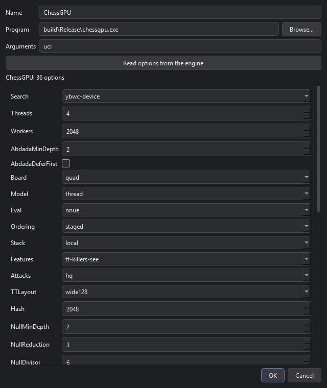
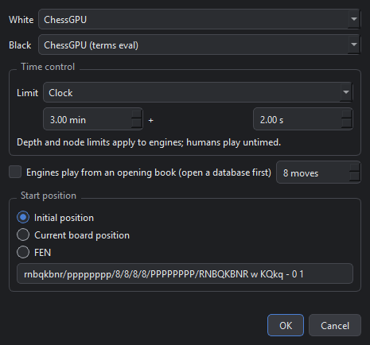
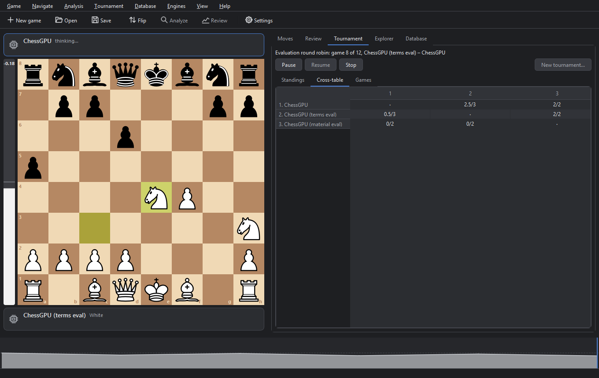
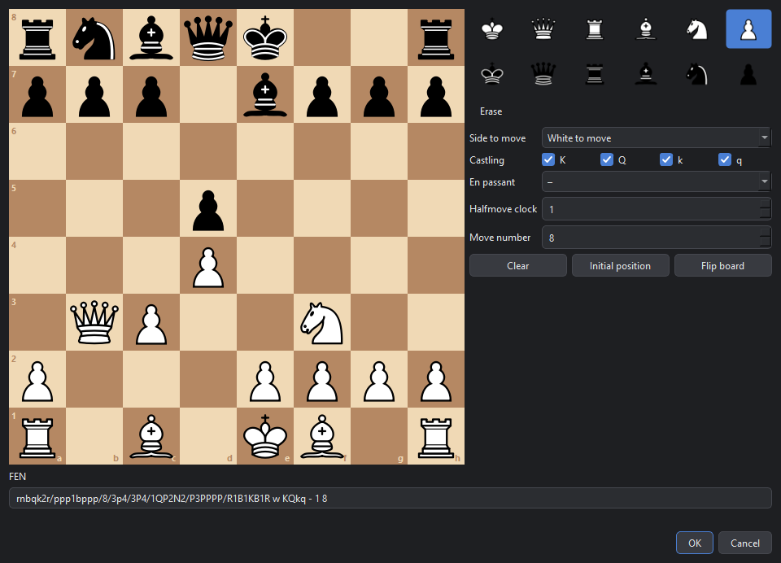
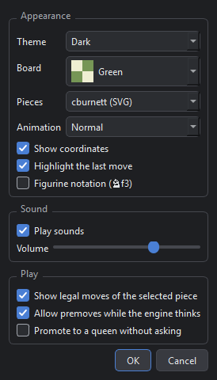

# The GUI

A desktop front end for UCI chess engines, made for ChessGPU and written in Python with PySide6 (Qt). It plays games, analyzes positions, keeps annotated game trees, reviews games for mistakes, runs engine tournaments, and opens PGN files as searchable databases with an opening explorer. It works with any UCI engine, so ChessGPU can play Stockfish, or one ChessGPU variant another.


Contents:
[Starting](#starting) ·
[The window](#the-window) ·
[Engines](#engines) ·
[Playing a game](#playing-a-game) ·
[The game tree](#the-game-tree) ·
[Analysis](#analysis) ·
[Game review](#game-review) ·
[Tournaments](#tournaments) ·
[Databases](#databases) ·
[Files](#files) ·
[Settings](#settings) ·
[Keyboard shortcuts](#keyboard-shortcuts) ·
[Troubleshooting](#troubleshooting)

## Starting

The GUI needs Python 3 (it was developed with 3.14) and PySide6, which `gui/requirements.txt` installs along with pytest for the tests. From the repository root:

```bash
python -m venv .venv
.venv/Scripts/pip install -r gui/requirements.txt
.venv/Scripts/python gui/main.py
```

Running `python -m chessgpu_gui` from `gui/` starts it too. To play ChessGPU, build the engine first ([ENGINE.md](ENGINE.md#building)).

The GUI keeps its settings, engine profiles and window layout in `gui.ini`, in the user's application settings folder (on Windows, `%LOCALAPPDATA%\ChessGPU\ChessGPU GUI\`). The sound files it makes on first use and the default folder for tournament games are there too.

## The window

- **The board,** with an eval bar on its left and a player card above and below it. A card shows who plays (a person or an engine), what they are doing, the material they are up, and their clock, which turns red under 20 seconds.
- **The side panel,** in five tabs:
  - *Moves:* the move list with variations and comments, a comment box, navigation buttons and the engines' output;
  - *Review:* a game review's results;
  - *Tournament:* a tournament's standings, cross-table and games;
  - *Explorer:* the moves played from the board's position in the open database;
  - *Database:* the open database's games.
- **The eval graph,** along the bottom: White's winning chances after every move of the line shown. Clicking it jumps to that move, and a game review marks its mistakes on it.
- **The toolbar:** New game, Open, Save, Flip, Analyze, Review and Settings.

## Engines

The GUI starts with these engine profiles:
- *ChessGPU*, from `build/Release/chessgpu.exe`;
- three ChessGPU variants: with the material evaluation, with the warp execution model, and with the CPU search;
- *Stockfish*, if it is at `tools/stockfish/stockfish/stockfish-windows-x86-64-universal.exe`. Elsewhere, add it as a profile.

**Engines → Manage engines** adds, changes and removes profiles. A profile is a program, its command-line arguments and the UCI options to start it with. The options form is built from the engine's own `option` lines (the GUI starts the engine to ask), so it covers every option an engine offers.



Two profiles of the same program with different options are two players, which is how ChessGPU's variants play each other: `Eval` set to `material` against the default NNUE, for example, or the warp execution model against the thread model. [ENGINE.md](ENGINE.md#uci-options) lists ChessGPU's options.

## Playing a game

**Game → New game** (Ctrl+N) sets up a game:
- *Players:* a person or any engine profile on each side, so a person can play an engine, engines can play each other, and two people can play.
- *Time control:* a clock (minutes, plus an increment per move), a time per move, a depth or a node count. Depth and node limits apply to engines, and people then play untimed.
- *Start position:* the initial position, the position on the board, or a FEN.
- *Opening book:* with an indexed database open, engines can play their first moves from its games (see [The opening book](#the-opening-book)).



**Moving:** click a piece and then its destination, or drag it. Dots show the selected piece's legal moves. A pawn reaching the last rank opens a picker on the board, unless the settings promote to a queen automatically.

**Premoves:** while the engine thinks, you can enter your next move. It is played the moment your turn comes, if it is still legal. A right click cancels it.

**During a game,** the **Game** menu has:
- *Take back* (Ctrl+Z): takes back your last move and the engine's reply, and puts the clocks back to what they were. It works after the game has ended too.
- *Move now* (Ctrl+M): makes the thinking engine play its best move so far.
- *Resign* and *Abort*.

**How games end:** checkmate, stalemate, threefold repetition, the 50-move rule, insufficient material, resignation, or a fallen flag. A fallen flag loses only if the opponent has more than a lone king; otherwise the game is drawn. An engine that plays an illegal move, returns no move or crashes loses. The clocks start only once every engine has answered its start-up handshake, so an engine's set-up time (the GPU search's, for example) isn't counted.

**While engines think,** each one's panel shows its depth, its score (from White's point of view), its nodes, speed and time, and its principal variation.


**Sounds** mark moves, captures, checks, castling, promotions, the start and end of a game, and your clock falling below 10 seconds.

## The game tree

A game is a tree of moves: the main line is the game itself, and variations are other moves tried from any position along the way.

- **Making variations:** outside a game, play a move on the board from any position. If that move is already in the tree, the board just goes to it; otherwise it becomes a new variation, or extends the line if nothing follows yet.
- **The move list** shows the main line in rows of two moves, with comments and variations in rows between them; variations inside variations appear in parentheses. Click any move to show its position.
- **Navigating:** Home, Left, Right and End move along the line shown: the moves leading to the position on the board, then the main continuation from it. Up and Down switch between the moves played from the same position.
- **Comments:** the box under the move list edits the comment on the move shown. At the start position, it edits the comment on the whole game.
- **Right-clicking a move** offers:
  - *Annotate,* with move marks (!, ?, !!, ??, !?, ?! and □ for an only move) and position marks (=, ∞, +=, =+, ±, ∓, +−, −+). Choosing a mark again removes it.
  - *Edit comment*, *Clear annotations*, *Copy line* (the moves leading to it, in numbered SAN) and *Copy FEN*.
  - *Promote variation*, *Make main line* and *Delete from here*, except while a game is being played.
- **Arrows and circles:** right-click a square for a circle, or right-drag for an arrow. They are green; hold Shift for red, Ctrl for blue or Alt for yellow. Drawing the same shape again removes it, and a left click clears them all. Each position keeps its own shapes, and they are saved in the PGN.

## Analysis

**Analysis → Analyze** (F5) has the analysis engine search the position shown, without a time limit, and follows along as you move through the game. **Analysis → Analysis engine** chooses the engine. Analysis is off while a game is being played.

- **Several lines:** the *Lines* box in the analysis panel asks for up to five best moves at once, from engines that have a MultiPV option (ChessGPU and Stockfish both do). Each line shows its score and moves, and the board shows each line's first move as an arrow, fainter for each worse line.
- **Playing a line:** click a move in a line to play the line up to that move, as a variation.
- **Threat** (X): what the opponent would play if it were their move. The engine analyzes the position after a pass, and its arrows turn red. There is no threat to show while the side to move is in check.
- **Hint** (H): on your turn in a game, the analysis engine thinks for 1.5 seconds and shows its move as an arrow.


## Game review


**Analysis → Review game** (Ctrl+R) has an engine evaluate every position of the game's main line, then judges each move. The dialog chooses the engine, how long it looks at each position (0.3, 1 or 3 seconds, or to depth 12 or 16), and whether to annotate the game. Short looks can miss tactics: a move the quick setting calls an inaccuracy may turn out to be a blunder on a longer look.

**How moves are judged.** A move's loss is how much it lowered the mover's expected score. The expected score comes from the engine's evaluation: 1 / (1 + 10^(−cp/400)) for an evaluation of cp centipawns, and 1 or 0 for a mate. A move the engine would have played itself loses nothing.

| Loss | Verdict | Mark |
|---|---|---|
| 7% or more | inaccuracy | ?! |
| 14% or more | mistake | ? |
| 25% or more | blunder | ?? |

**The results,** in the Review tab, give for each side:
- accuracy: the mean of its moves' accuracy, which is 100 · e^(−4 · loss) for a move;
- average centipawn loss (ACPL), counting evaluations beyond ±1000 as ±1000;
- the number of inaccuracies, mistakes and blunders.

Below them are the moves to look at, each with the engine's preferred move; clicking one shows it. The eval graph marks the same moves. A review can be stopped part-way, and the moves reviewed so far are judged.

**Annotating** marks each judged move with its symbol, adds a comment such as "Mistake. Nf3 was best.", and adds the engine's line as a variation. The review's evaluations are saved with the game (as `[%eval]` in the PGN), so a reviewed game shows its review again when it is reopened.

## Tournaments


**Tournament → New tournament** (Ctrl+T) runs a tournament between engine profiles. Games are played one at a time on the main board, so the board, the player cards and the engines' output follow the game being played.

**The tournament dialog** sets:
- *Engines and format:* a round robin, where every engine plays every other, or a gauntlet, where one engine plays all the others.
- *Rounds:* in each round, every pairing plays one opening twice, once with each color. Each pairing gets a new opening every round.
- *Time control,* as for a single game.
- *Openings:* the start position, the built-in set of 200 balanced openings (the set the engine's own matches use), an EPD file (each line's position is an opening) or a PGN file (each game's first moves are an opening), shuffled or in order.
- *Adjudication,* following fishtest's rules: a win when both engines agree on a score of at least 600 centipawns for the same side for 3 moves each, and a draw from move 34 when both report scores within 20 centipawns for 8 moves each. A move limit can also end games as draws.
- *Games file:* a PGN that each game is added to as it finishes.

**The Tournament tab** has:
- *Pause, Resume and Stop.* Pause lets the current game finish, then waits; Stop aborts the current game without counting it.
- *Standings:* games, wins, draws, losses, points, score, and an Elo estimate with a 95% error bar. The estimate turns each engine's score against the field into an Elo difference; hovering over it shows the likelihood of superiority.
- *Cross-table:* the points of every pairing.
- *Games:* the finished games. Double-click one to open it, when no tournament game is being played.



**Resuming:** the tournament's state is saved after every game, in a JSON file next to the games file. **Tournament → Resume a saved tournament** opens that file and plays the games still missing, even after the GUI was closed.

**Notes:**
- While a tournament game is being played, the GUI refuses what would replace it: a new game, opening a file, analysis, a review. Pause or stop the tournament first.
- Engines stay running between games, so a GPU engine sets itself up only once.
- Games are played one at a time because GPU engines share the GPU, and timing is only fair when each has it to itself.

## Databases

**Database → Open database** (Ctrl+Shift+O) opens a PGN file as a database; **Add PGN file** adds another file's games, and **Close database** closes it. Opening only scans the file for each game's tags, so large files open fast, and a game is read in full when you open it.

Meanwhile, worker processes build a **position index** in the background, with a progress bar: for every position in each game's first 20 moves, the moves played from it with their results, and the games that reached it. The position filter, the explorer and the opening book all work from it.

**The Database tab** lists the games:
- search by player, event, site or opening, and filter by result;
- tick *Reaching the board's position* to keep only the games that reached the position on the board within their first 20 moves;
- click a column header to sort, and double-click a game to open it.


### The explorer

**The Explorer tab** lists the moves played from the position on the board, most played first, each with its number of games and a bar of White wins, draws and Black wins (hovering over a bar shows the counts). Clicking a move plays it on the board.


### The opening book

With an indexed database open, the New game dialog offers to let engines play from the book for the game's first moves. An engine whose turn it is then plays a move from the database's games instead of searching, choosing each move in proportion to how often it was played. Once the game leaves the book, engines search as usual. Book moves are commented "book".

## Files

### PGN

**Game → Open PGN** (Ctrl+O) opens a game; if the file holds several, you pick one. **Save PGN** (Ctrl+S) writes the game in the PGN export format, with its variations, comments and annotation marks. Comments also carry these commands:

| Command | Holds | Example |
|---|---|---|
| `[%cal]` | arrows | `[%cal Ge2e4,Rd8d1]` |
| `[%csl]` | circles | `[%csl Gd5]` |
| `[%clk]` | the clock after the move | `[%clk 0:03:12]` |
| `[%eval]` | a review's evaluation, from White's side | `[%eval 0.35,18]` (with the depth), `[%eval #-3]` |

An engine's moves carry its report in the format cutechess and fastchess write: `+0.35/12 1.234s` is the score from the engine's side, the depth and the time.

Reading is tolerant: any tag order, comments in braces or after a semicolon, annotation marks and NAGs, nested variations, escape lines and several games per file. A variation with an illegal move keeps its moves up to that move. If the last comment says why the game ended, as fastchess writes it, that is read back too.

### FEN and positions

**Copy FEN** (Ctrl+Shift+C) and **Paste FEN** (Ctrl+Shift+V) copy the position on the board and set one up. **Game → Edit position** (Ctrl+E) opens a board editor for placing pieces and setting the side to move, castling rights, the en passant square and the move counters; it accepts only legal positions.



## Settings

**View → Settings** (Ctrl+,) holds the look and feel:
- *Theme:* dark or light, for the whole window.
- *Board:* brown, green, blue, slate, purple or coral squares.
- *Pieces:* cburnett, Unicode glyphs, or this project's own vector drawings.
- *Animation:* moves slide into place, fast, at normal speed, slowly or not at all. Castling moves the rook too, captured pieces fade, and stepping back plays the move in reverse.
- *Sounds,* and their volume.
- *Play options:* whether to show legal moves, coordinates and the last move, whether to allow premoves, whether to promote to a queen without asking, and whether to use figurines (♘f3 rather than Nf3).



The **View** menu also flips the board (F), switches the theme, board colors and pieces directly, and opens the **engine log**, which shows every line sent to and received from every engine.

## Keyboard shortcuts

**Help → Keyboard shortcuts** (F1) lists these in the GUI too.

| Keys | Action |
|---|---|
| Ctrl+N | New game |
| Ctrl+O / Ctrl+S | Open / save a PGN |
| Ctrl+Shift+C / Ctrl+Shift+V | Copy / paste a FEN |
| Ctrl+E | Edit the position |
| Ctrl+Z | Take back |
| Ctrl+M | Make the engine move now |
| Home / End | Start / end of the line shown |
| Left / Right | One move back / forward |
| Up / Down | Previous / next variation |
| F5 | Analyze |
| X | Show the threat |
| H | Hint |
| Ctrl+R | Review the game |
| Ctrl+T | New tournament |
| Ctrl+Shift+O | Open a database |
| F | Flip the board |
| Ctrl+, | Settings |
| F1 | Keyboard shortcuts |
| Ctrl+Q | Quit |

On the board, right-click a square for a circle and right-drag for an arrow (Shift red, Ctrl blue, Alt yellow). A left click clears them, and a right click cancels premoves.

## Troubleshooting

- **ChessGPU "failed to start":** the engine isn't built yet, or its profile points to the wrong place. Build it ([ENGINE.md](ENGINE.md#building)), or fix the path under **Engines → Manage engines**.
- **A GPU engine's first move takes a moment:** the engine sets up the GPU and its transposition table when it starts. The game's clock waits for it.
- **Only one analysis line:** the engine has no MultiPV option.
- **No sounds:** sounds play only through Windows' built-in player.
- **An engine misbehaves:** the engine log (View menu) shows exactly what it was sent and what it answered.
